# Back Then

**See what this day looked like, every year.**

Back Then is an iPhone and Android app that opens on today's date and shows the
photos you took on this same day in past years, one year at a time. Pick any other
day from a calendar, keep the best shots in Favorites, and gather photos into albums
you can share.

Both apps are fully native: Swift and SwiftUI on iPhone, Kotlin and Jetpack Compose
on Android. They read photos from the phone's own library only, and nothing leaves
the phone.

<table>
  <tr>
    <th>Today</th>
    <th>Pick a day</th>
    <th>Photo viewer</th>
  </tr>
  <tr>
    <td>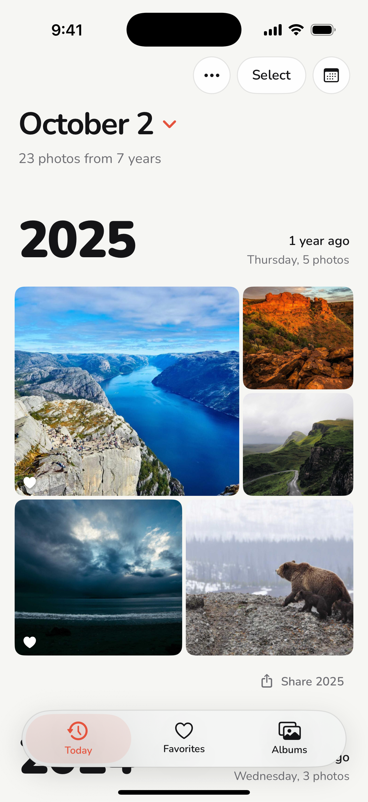</td>
    <td>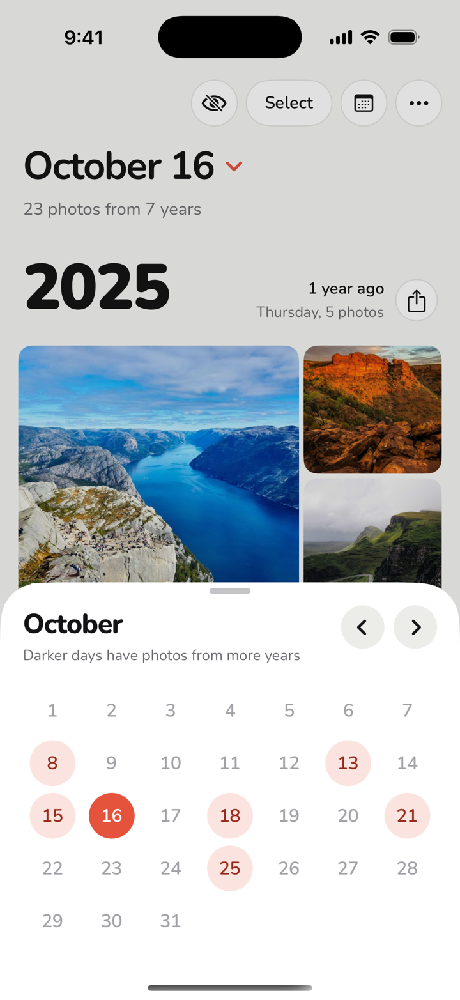</td>
    <td>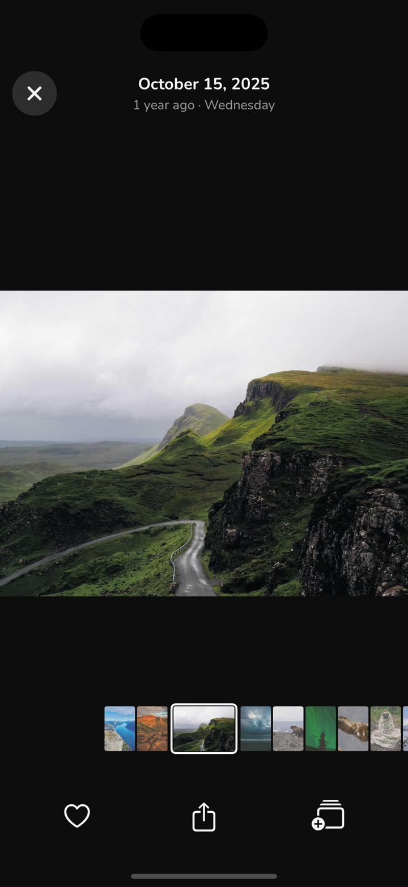</td>
  </tr>
  <tr>
    <th>Favorites</th>
    <th>An album</th>
    <th>First launch</th>
  </tr>
  <tr>
    <td>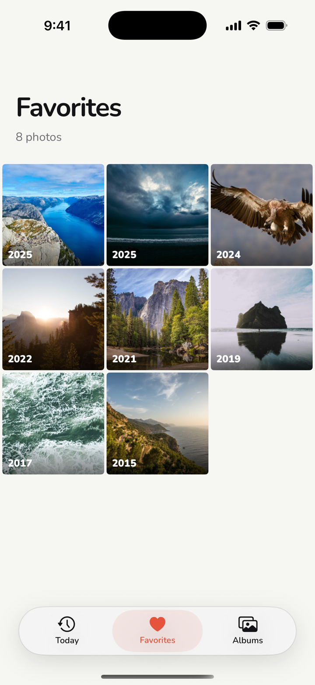</td>
    <td>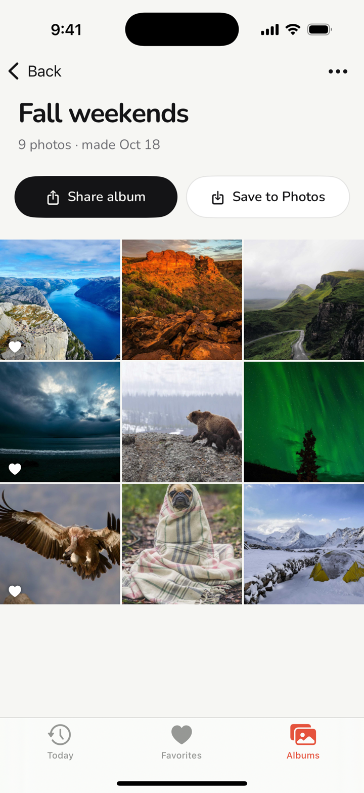</td>
    <td>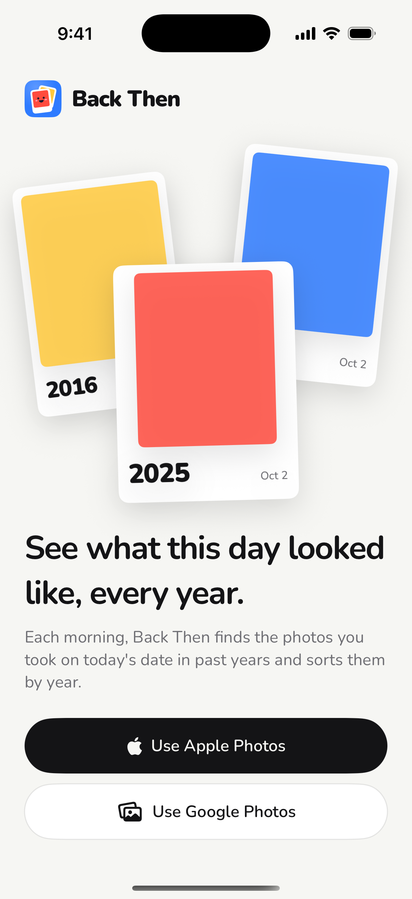</td>
  </tr>
</table>

### On Android

<table>
  <tr>
    <td>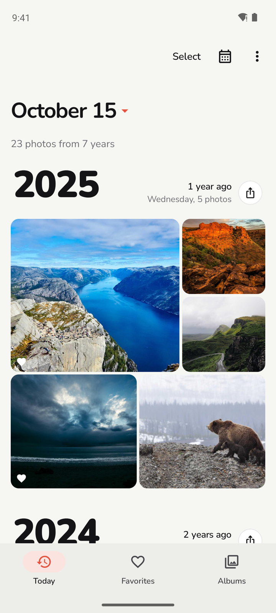</td>
    <td>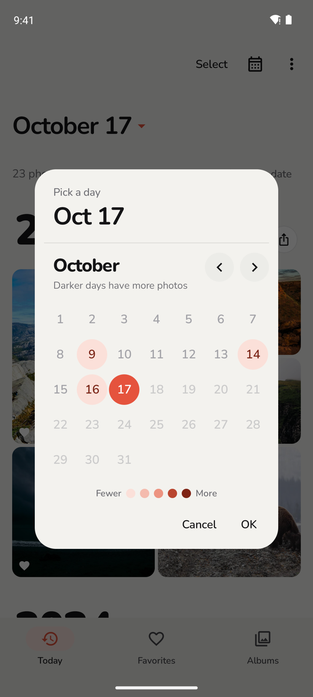</td>
    <td>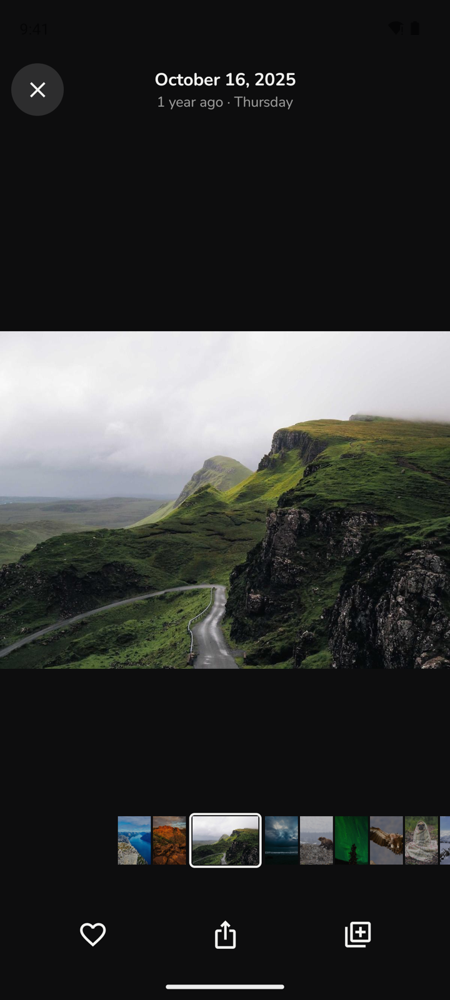</td>
    <td>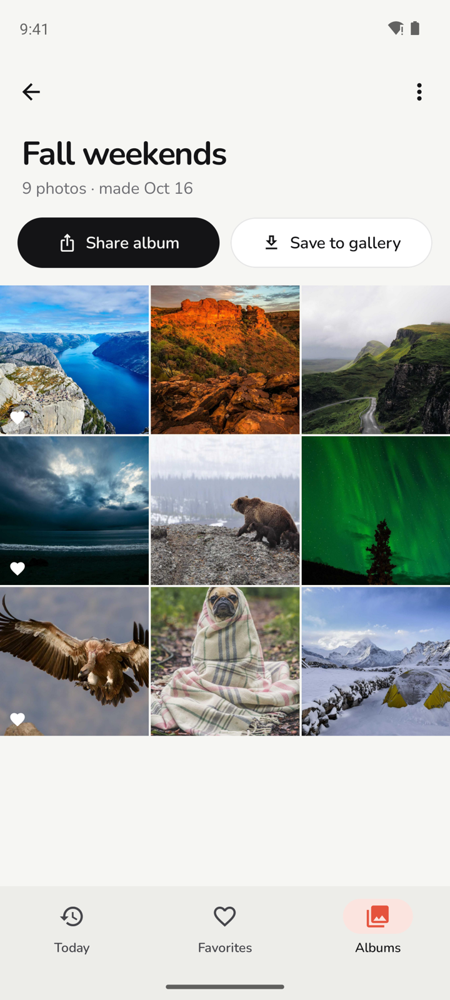</td>
  </tr>
</table>

### In Arabic

The whole app turns right to left, with an Arabic font and Arabic month names.

<table>
  <tr>
    <th>iPhone: Today</th>
    <th>iPhone: Pick a day</th>
    <th>iPhone: First launch</th>
  </tr>
  <tr>
    <td>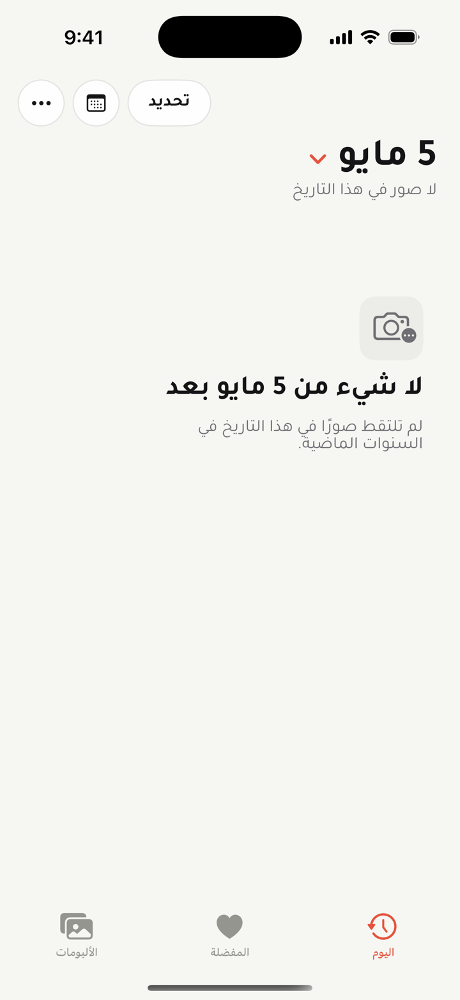</td>
    <td>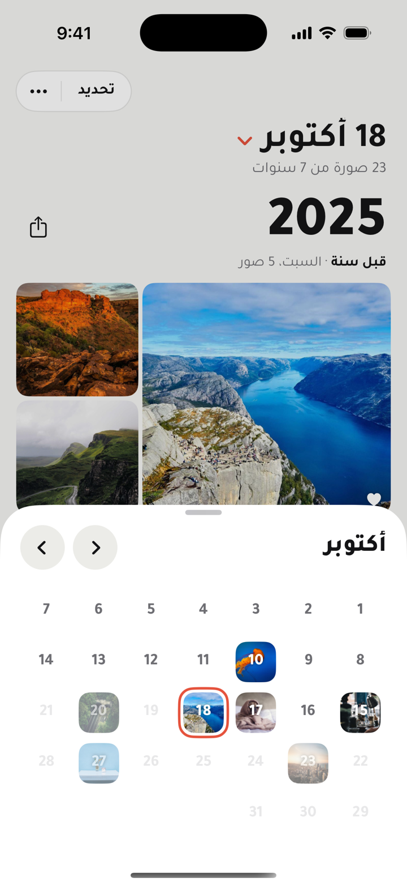</td>
    <td>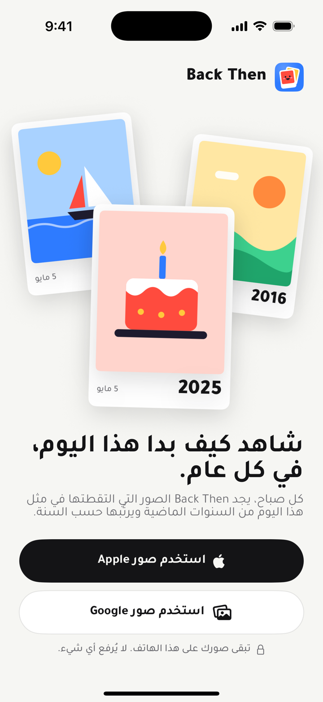</td>
  </tr>
  <tr>
    <th>iPhone: Photo viewer</th>
    <th>iPhone: Favorites</th>
    <th>iPhone: An album</th>
  </tr>
  <tr>
    <td>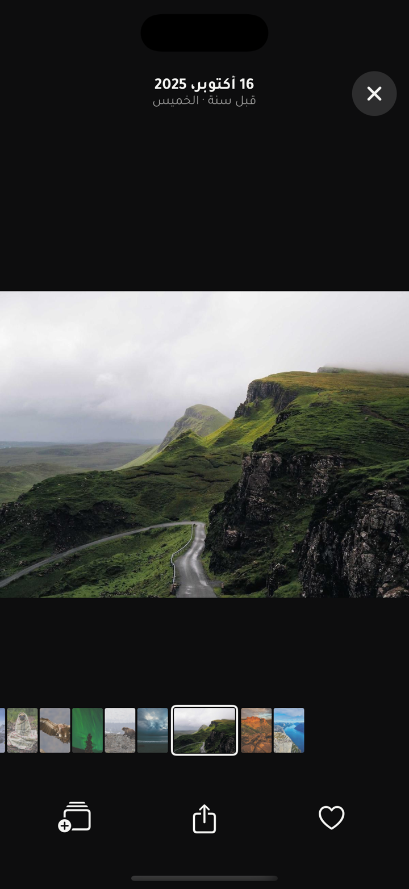</td>
    <td>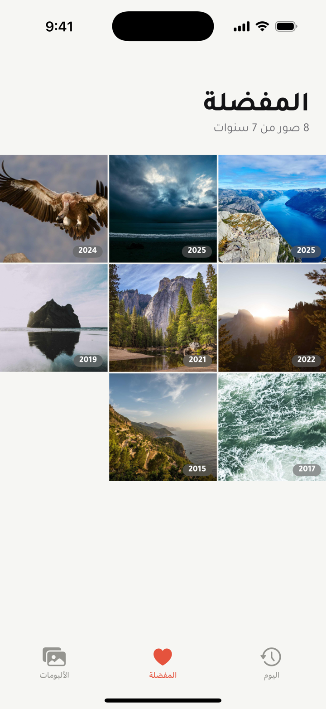</td>
    <td>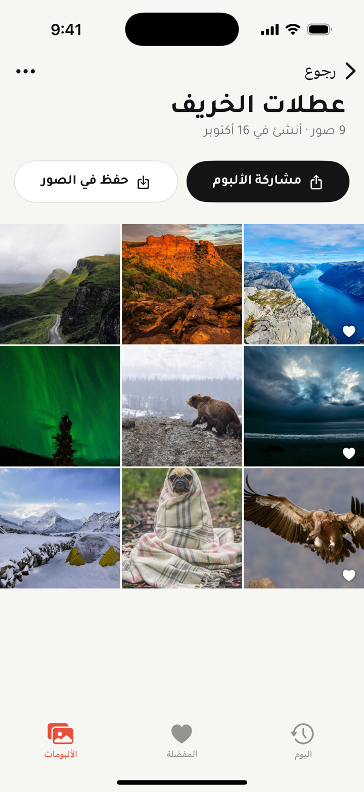</td>
  </tr>
</table>

<table>
  <tr>
    <td>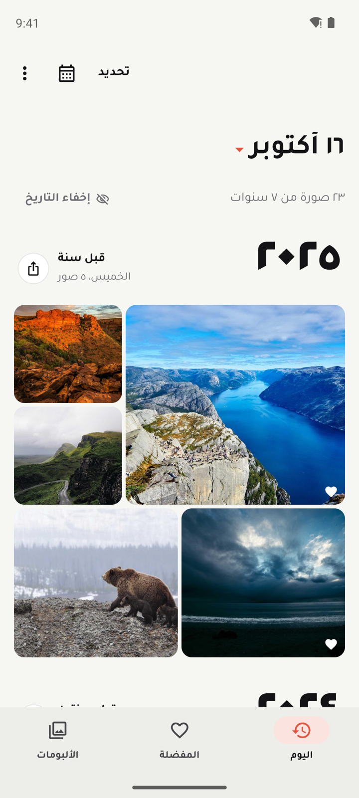</td>
    <td>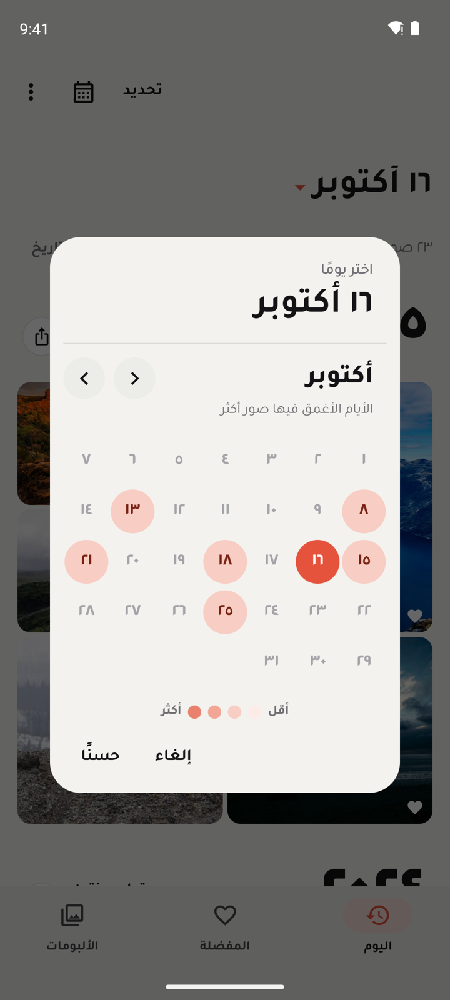</td>
    <td>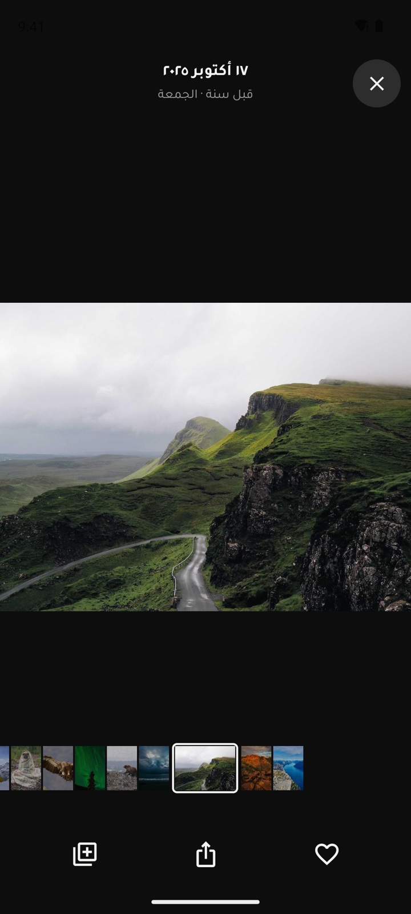</td>
    <td>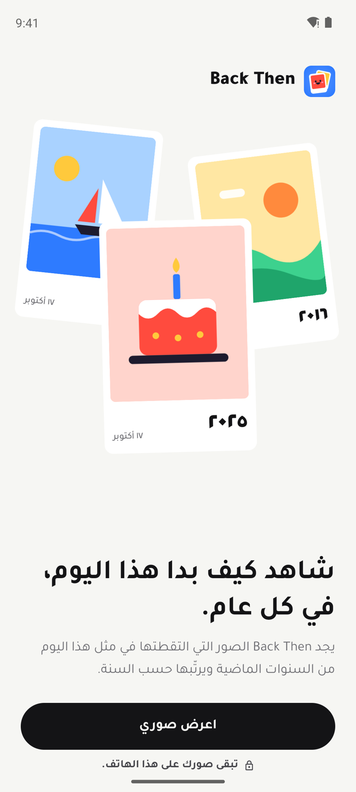</td>
  </tr>
</table>

The photos in these screenshots are samples from [Lorem Picsum](https://picsum.photos),
stamped with past dates. The [Screenshots workflow](.github/workflows/screenshots.yml)
takes them from the real apps on an iPhone simulator and an Android emulator. (A
simulator can't be given photo access without a tap, so on iPhone a debug build
loads the samples from a folder in the app instead.)

## What it does

- **Today.** Every past year that has photos on this date, newest first. Each year
  gets a large year number, how long ago it was, a share button, and a mosaic of
  that day's photos. While you scroll, the year you are in stays pinned at the top.
  Or switch to one year at a time from the ••• menu. Pull down to check the library
  for new photos. Hide a date you'd rather not see again.
- **Pick a day.** A month-and-day calendar (no year, since every year shows at once).
  Tap the date title to open it. Each day with photos shows a tiny copy of one of
  them: a favorite from that day, or the newest year's first photo. One tap opens a
  day. Days still to come this year can't be picked. Swipe to change month. A day
  with no photos offers the closest days that have some.
- **Photo viewer.** Swipe through a day's photos or jump with the filmstrip. Pinch
  or double tap to zoom, swipe down to close, tap to hide the buttons. Heart a photo,
  share it, or add it to an album.
- **Favorites.** Every photo you've hearted, from any day, with its year on each tile.
- **Albums.** On Today, tap Select, pick photos, then tap Album. Share an album
  through any app, or save it as a real album in Photos (iPhone) or under
  Pictures/Back Then (Android). Rename or delete it from the album's menu.
- **Home screen widget.** A photo from this day in a past year, with its year and
  how long ago, in small and medium sizes. It picks another photo every hour and
  opens Today when tapped.
- **Daily reminder.** One notification a day at a time you choose, and only on days
  that have photos from past years. Tapping it opens that day.
- **Looks native on each phone.** The system tab bar and sheets on iPhone, with text
  that grows with the system text size; a large top app bar and navigation bar on
  Android. Light and dark mode.

## What's new in 1.12

A design pass from two reviews of the apps.

- **A calmer top bar on Today.** The bar now holds only Select and a ••• menu. The
  menu has Hide date, All years, One year at a time, and Settings. Tap the date title
  to open the calendar. Each year shows its number with a plain share button, and one
  line under it: how long ago, the weekday, and the photo count.
- **Photos in the calendar.** With normal photo counts most days ended up the same
  pale shade. Now each day with photos shows a tiny copy of a favorite from that day,
  or else the newest year's first photo, with the day number in white. The picked
  day gets a coral ring. Past days with no photos are gray, so they read apart from
  days still to come. The legend and hint line are gone.
- **One tap on Android.** The Android calendar is now a bottom sheet like the iPhone
  one. One tap on a day opens it, with no OK button.
- **"Show my photos".** The welcome button no longer shows the Apple logo, and the
  privacy line under it is easier to read.
- **Hearts stay readable.** A soft dark wash in the tile corner keeps the heart clear
  on bright photos, and screen readers now say "Favorite photo from 2019".
- **Photo viewer.** The header says where you are, like "3 of 5". The buttons have
  short labels under them, and filmstrip thumbnails are easier to hit. On Android the
  status bar icons stay light on the dark viewer.
- **Small fixes.** Year buttons, the Back to today button and the reminder time are
  easier to tap. On iPhone, Reduce Motion turns off the press and toast motion. The
  toast check mark shows in dark mode. Android stays in portrait, like the iPhone app.

## What's new in 1.10

Fixes from a full code check.

- **Today keeps up with the date.** Phones keep the app open in the background, so
  coming back the next morning used to show yesterday. Now Today moves to the new
  day, unless you had picked another day yourself.
- **Reminder time changes take hold on Android.** Before, a new time was ignored once
  the first reminder had gone off. On iPhone, tapping the time button quickly no
  longer leaves some days at an older time.
- **Safer saves on Android.** If the save file ever fails to load, the app keeps it as
  `state.bad.json` instead of writing over it, so albums and favorites can be brought
  back. A full disk no longer crashes the app.
- **Hidden days stay hidden in the iPhone widget.** If the widget can't read the app's
  settings, it asks you to open the app instead of showing photos.
- **Better Save to gallery on Android.** HEIC and PNG photos keep their own type
  instead of being labeled JPEG, saving an album again skips photos already there,
  and the button no longer shows on Android 8 and 9, where it could never work. The
  unused storage permission is gone.
- **Sturdier reminder taps.** The Android app checks the day it is asked to open, so
  another app can't crash it with a bad date.
- **Built apps moved to a GitHub release.** The APK, Play bundle and iPhone Simulator
  app now go on the [Latest build](../../releases/tag/latest-build) release instead of
  the `build/` folder, so the repo no longer grows by about 25 MB with every build.
- Unused code left from Google Photos is gone.

## What's new in 1.9

Photos on the phone only. Google Photos sign-in is gone from both apps.

- **One source.** The apps read the phone's library (Apple Photos on iPhone, the
  gallery on Android) and nothing else. The welcome screen has one button, and the
  "..." menu no longer lists Google Photos.
- **No internet.** The Android app no longer asks for internet access, and neither
  app talks to any server. The Google sign-in library is out of the Android build.
- **Clean update.** Photos picked from Google Photos in 1.8 drop out of Favorites and
  albums, and the app deletes its copies of them and the saved Google sign-in. Phone
  photos, albums, hidden days and settings stay as they were.
- **Privacy policy and Play listing** now say the app uses only photos on the phone.
  The Data safety answers stay "no data collected or shared".

## What's new in 1.8

Google Photos sign-in.

- **Google Photos turned on.** The iPhone app now carries its Google client ID, so
  Add Google Photos opens the Google sign-in instead of saying the build has no
  client ID. Android finds its Google client by package name and signing key.
- **Steady signing key for the test APK.** The Build apps workflow now signs the
  Android APK in build/ with the Play upload key when it is in GitHub secrets.
  Before, each run made a new throwaway key, so Google could never match it.
- **Smaller, harder to read release build.** The Android release build now runs R8,
  which strips unused code and renames the rest. Google Play warned about the 1.6
  bundle for skipping this. A new CI job installs the shrunk build on an emulator and
  fails if it crashes.
- **Setup guide** for the Google Cloud steps (removed in 1.9 with Google Photos).

## What's new in 1.7

- **Home screen widget, on both phones.** Add "Back Then" from the widget picker. It
  shows a photo from this day in a past year, with the year and how long ago, and
  picks another photo from the day every hour. Tap it to open Today. With no photos
  that day, or before you allow photo access, it shows the date and a short note.
  Hidden days never show up in it. On iPhone it shows photos from the phone's
  library; on Android it also shows your Google Photos picks.
- **Only today and past days in the calendar.** Days still to come this year are
  greyed out and can't be tapped.
- **Calendar colors follow the photo count.** Before, each day's shade came from its
  rank among your other days, so a day with 3 photos could look as dark as one with
  300, and the lightest shade was hard to see. Now the shade follows how many photos
  a day has, on a log scale (1, a few, around 10, dozens, a lot), in five shades from
  a clear tint to a deep brick red. The top shade starts where your busiest tenth of
  days are, so one huge day (a wedding, a trip) doesn't make every other day look
  empty. The deep red is darker than the coral used for the chosen day, so the two
  don't mix up.

To try the iPhone widget from Xcode: run the app once, then add the widget from the
home screen. The app and widget share a small settings file through an App Group
(`group.com.njarrar.backthen`), so the widget knows your hidden days. Xcode sets it
up when you pick your team for both the **BackThen** and **BackThenWidget** targets.

## What's new in 1.6

Ready for Google Play.

- **Play Store kit.** A new [Play Store workflow](.github/workflows/play.yml) builds
  a release bundle (`build/BackThen-Android.aab`), takes phone screenshots in all
  four languages, and makes the app icon and feature graphics. The store text,
  privacy policy and a step by step guide live in [play-store/](play-store).
- **Signed release builds.** The release build signs with your Play upload key when
  the key is in GitHub secrets. The key never goes in the repo.
- **Android 16.** The Android app now targets Android 16 (API 36), which Google Play
  needs for new apps since August 31, 2026.
- **No advertising ID.** The Android app blocks the advertising ID permission, since
  it has no ads or tracking.
- The Screenshots workflow can shoot any set of languages (`LANGS`).
- **Privacy policy.** [play-store/privacy-policy.md](play-store/privacy-policy.md) covers
  what each app reads and keeps, Google Photos and Google's Limited Use rules,
  backups, sharing, and your rights. Play links to it.

## What's new in 1.5

Faster loading and scrolling, a calendar that shows how full each day is, and a
round of small fixes, on both apps.

- **Calendar shows how full each day is.** Before, a day's shade came from how many
  years had photos, so with a few years of photos almost every day looked the same.
  Now the shade comes from how many photos the day has. Days with photos are ranked
  and split into four even groups, from light to dark, so the shades spread out
  whether you have a hundred photos or a hundred thousand. A Fewer to More key sits
  under the month, and screen readers hear "October 16, 12 photos from 3 years".
- **Faster opening.** Coming back to the app no longer reads the whole library when
  nothing changed. A day's photos come from one library query instead of one per
  year. The day counts, favorites and date formats are worked out once and kept,
  instead of on every redraw.
- **Smoother scrolling.** Photos that scroll away stop loading. Thumbnails already
  in memory show at once with no gray flash. Google Photos files are shrunk while
  they load instead of after. On Android, Favorites and album pages build only the
  rows on screen, and Today's photo mosaic lays out in one pass.
- **Pull to refresh on Android,** as on iPhone. On both apps it always reads the
  whole library again, even when the quick check says nothing changed.
- **Fixes.**
  - Photo viewer: dragging up no longer moves the photo off the top, and a drag that
    went up first no longer closes the viewer.
  - Today reloads when new photos land on a day that already had some.
  - Turning off Google Photos updates the daily reminder.
  - The calendar's arrows keep up with quick taps (iPhone).
  - Tapping the reminder closes an open photo and shows Today; turning the phone no
    longer jumps back to the reminder's day (Android).
  - An album named with braces, such as "{n}", shows its name as typed.
  - Sharing skips a Google photo whose file is gone instead of failing, cleans up
    its temporary files, and sends JPEGs as they are, with their date and place.
  - Share album and Save are off for an empty album.
  - Arabic: the photo stack in the share sheet stays inside its box.
  - Adding Google photos while offline says it failed instead of opening the Google
    sign-in page (iPhone), and a failed Google download leaves no half file behind.

## What's new in 1.4

- **Four languages.** English, French, Spanish and Arabic. The app follows the
  phone's language (on iPhone, also the app's own language in Settings). Dates,
  times and numbers are written the way that language writes them, so French gets
  "16 octobre" and a 24 hour clock.
- **Arabic, right to left.** Every screen flips: the back arrow, the calendar (the
  first day sits on the right and swipes go the other way), the photo mosaic, the
  viewer and the tab order. Arabic text uses the Tajawal font, since Nunito has no
  Arabic letters, with normal letter spacing (tight spacing breaks joined letters)
  and taller lines. Counts use all six Arabic plural forms, such as صورتان for two
  photos, and digits follow the phone's setting (Western or Arabic).
- **One file per language** in [`lang/`](lang), shared by both apps. See
  [Languages](#languages) for how to add one.
- **iPhone unit tests** run in CI again, with new tests for the language files on
  both apps.
- **Everything from 1.1 in the new design.** Hidden dates, one year at a time and
  the share sheet now sit in the 1.3 design and speak all four languages. The Hide
  date button is in the top bar on iPhone and next to the photo count on Android.
- **Gregorian dates everywhere.** A phone set to the Hijri calendar (the default in
  Saudi Arabia) still sees the right day's photos, and dates read the usual way.
- **Built apps in `build/`.** An Android APK and an iPhone Simulator app,
  rebuilt by the Build apps workflow.

## What's new in 1.3

A design pass to make the app calmer and easier to use. Every change is on both
apps.

- **Tabs keep their place.** Switching tabs keeps each tab's scroll position and
  open album. Tap the active tab again to go back to the top. On iPhone the tab bar
  is now the system one, and an album page has the normal back swipe.
- **Today header.** The buttons read Select, calendar, then the menu. Share moved
  into each year's header as a round button, and there is less empty space above the
  first year. On Android the date is the title of the top bar.
- **The year stays in view.** While you scroll, the top bar blurs and shows a small
  date title, and the current year pins under it until the next year pushes it out.
- **Photo grids.** Favorites and album pages run edge to edge with thin gaps. The
  year on Favorites tiles is a small chip instead of a dark gradient.
- **Photo viewer.** Zoom, swipe down to close, tap to hide the buttons, and a
  filmstrip in place of the page dots and "3 of 23".
- **Calendar.** Days are shaded by how many years have photos instead of dotted.
  Swipe to change month; a Today button shows when you are away from today.
- **Album page.** Two clear buttons, Share album and Save, with Rename and Delete in
  the menu. Rename is new.
- **Welcome.** The three prints show small drawings, and a line says your photos
  stay on the phone.
- **Under the hood.** Text grows with the iPhone text size, every iPhone corner is
  smooth and on one scale, album rows answer a press at once, and light haptics mark
  picks, hearts, new albums and month or photo changes.

## What's new in 1.1

- **Hidden dates.** Hide a date with the "Hide date" button on Today (the eye on
  iPhone) or from the "..." menu. It stops coming up on
  its own: no reminder, no calendar shading, and it isn't offered as a nearby day. The
  menu lists hidden dates so you can show any of them again.
- **One year at a time.** A second layout from the design, picked in the "..." menu.
  Year buttons stay at the top, each year gets a huge year number and two columns
  of photos, and arrows step to the next or previous year.
- **Share sheet.** Sharing a year, a selection or an album now opens a sheet with a
  preview first. From there, send the photos through any app or save copies to an
  album in Photos (iPhone) or under Pictures/Back Then (Android).
- **Reminder time** shows in the phone's 12 or 24 hour style.
- **Fixes.** Settings are saved in order, so a fast run of taps can't leave an older
  state on disk. A failed album save on Android no longer leaves empty files in the
  gallery. Google Photos calls time out instead of hanging, and the sign-in token is
  only ever sent to Google. iPhone keeps recent thumbnails in memory, so scrolling
  back up doesn't reload them.
- **iPhone unit tests**, run in CI alongside the Android ones.

## Where the photos come from

**The phone's library**, through PhotoKit on iPhone and MediaStore on Android. On
Android this includes Google Photos pictures that are stored on the phone. The apps
have no account, no sign-in and no server, so nothing leaves the phone unless you
share it.

## Languages

Every word the apps show lives in one XML file per language in [`lang/`](lang):
`en.xml`, `fr.xml`, `es.xml` and `ar.xml`. Both apps read the same files. Android
packs the folder as app assets; on iPhone a build step copies it into the app.

```xml
<language name="Français" dir="ltr" script="latin">
    <string name="tab_today">Aujourd'hui</string>
    <string name="photos_from_years">{photos} sur {years}</string>
    <plurals name="photos">
        <item quantity="one">{n} photo</item>
        <item quantity="other">{n} photos</item>
    </plurals>
</language>
```

At launch each app picks the first language in the phone's list that has a file,
and falls back to English. A word missing from a file also comes from English.
Words hold `{slots}` that the app fills in, so each language can put them in its
own order. In code, `L.s("tab_today")` gets a word and `L.p("photos", 3)` gets a
plural, the same on both apps.

**To add a language:**

1. Copy `lang/en.xml` to `lang/<code>.xml`, such as `de.xml` or `pt-BR.xml`.
2. Set `name`, `dir="rtl"` for a right to left language, and `script="arabic"` for
   one written in Arabic script (Persian, Urdu).
3. Translate the text between the tags, keeping the `{slots}`. Give each plural the
   forms the language uses (`zero`, `one`, `two`, `few`, `many`, `other`).
4. Run the tests. They check that the file has every word and the same slots.

That's all for both apps. If the language has plural rules the apps don't know yet,
add a line to `pluralForm` in `ios/BackThen/Core/Lang.swift` and
`android/.../core/Lang.kt`; the common ones are already there.

## Running the apps

| | iPhone | Android |
|---|---|---|
| Needs | Xcode 16, iOS 17 or later | Android Studio, Android 8 or later |
| Open | `ios/BackThen.xcodeproj` | the `android/` folder |
| Run | pick your team under Signing, then Run | Run, or `cd android && ./gradlew installDebug` |
| Tests | Product > Test (⌘U) | `./gradlew testDebugUnitTest` |

GitHub Actions builds both apps and runs their unit tests on every push. The Android run also uploads a debug
APK you can install on a phone.

### Built apps

The [Latest build](../../releases/tag/latest-build) release holds ready-made copies of
both apps. The [Build apps workflow](.github/workflows/build.yml) makes them; run it
again from the Actions tab after app changes. Each run replaces the files.

| File | What it is | Where it runs |
|---|---|---|
| `BackThen-Android.apk` | Debug build of the Android app | Any Android 8 or later phone. Open the file on the phone and allow installs from that source. |
| `BackThen-Android.aab` | Release bundle for Google Play, made by the [Play Store workflow](.github/workflows/play.yml) | Upload to the Play Console. It can't be installed on a phone directly. See [play-store/README.md](play-store/README.md). |
| `BackThen-iOS-Simulator.zip` | Unsigned iPhone app built for the simulator | Only the iOS Simulator on a Mac. Unzip it and drag `Back Then.app` onto a running simulator. It will not install on a real iPhone. |

A build for a real iPhone needs an Apple Developer account and its signing
certificate and profile. With those, a signed build can go out through TestFlight.

### Publishing on Google Play

The Android package name is `com.njarrar.backthen`. Follow
[play-store/README.md](play-store/README.md): make an upload key, add it to GitHub
secrets, run the Play Store workflow, then fill in the Play Console from the files in
[play-store/](play-store).

## How the code is laid out

The two apps share no code, but each has the same core logic, so they behave alike:
a day index that counts photos per day and year, the nearby-days search, and the
mosaic patterns.

```
lang/        one XML file per language, read by both apps
ios/BackThen/
  Core/      dates, day index, mosaic layout, language files
  Data/      PhotoKit, reminders, app state
  Views/     Today, calendar, viewer, Favorites, Albums, onboarding
ios/BackThenWidget/ the home screen widget (it shares Core/ with the app)
ios/BackThenTests/  unit tests
ios/scripts/        build step that copies lang/ into the app
android/app/src/main/java/com/njarrar/backthen/
  core/      the same core logic, with unit tests
  data/      MediaStore, reminders, saved state
  ui/        Compose screens
  widget/    the home screen widget
design/      the source design (open "On This Day.dc.html") and the Nunito and Tajawal font licenses
```

Debug builds accept a `scene` launch argument (`today`, `calendar`, `viewer`,
`favorites`, `album`) that fills the app with sample data. The Screenshots workflow
uses it, once in English and once in Arabic; release builds ignore it.

## Not built yet

- **Share an album as a link.** The design shows `backthen.app/a/...` links. That
  needs a server to host the photos, so for now photos share as files.
